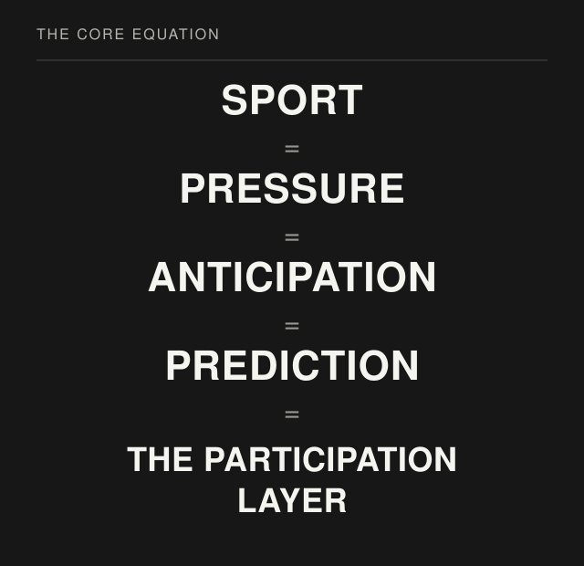
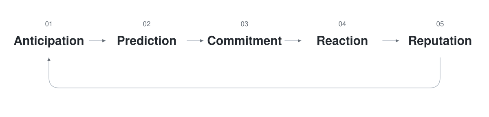
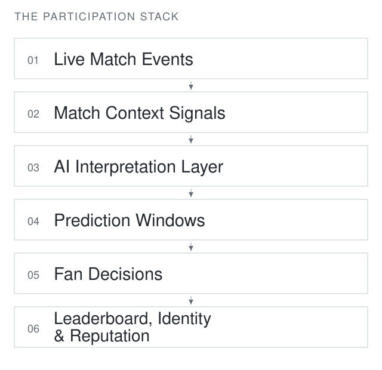

# Sport Is Pressure

### The Participation Layer of Live Sports

Cristian Plop · Pulse Research · 2026

[Read the full paper →](paper/sport-is-pressure.pdf)  
[Published on SSRN →](https://papers.ssrn.com/sol3/papers.cfm?abstract_id=6393138)

Live sports are defined by anticipation. Fans interpret what is happening, predict what comes next, debate decisions, and react in real time. Yet most sports products treat them primarily as spectators.

This paper proposes **the participation layer**: a system that turns the prediction instinct fans already have into structured, social, and persistent participation during live sport.

## The fan participation loop

Anticipation becomes a specific prediction. Stating that prediction makes it a commitment. The match resolves the uncertainty; the fan reacts to being right or wrong. When outcomes are recorded and visible to others, they contribute to reputation.

The behavior already happens in group chats, living rooms, and stadium conversations. The participation layer gives it **structure, persistence, and social consequence**.

## The missing layer

The paper distinguishes four relationships with the match:

| Product | Optimizes for | Relationship with the match |
| :--- | :--- | :--- |
| Broadcast | Attention | Passive viewing |
| Betting | Transactions | Financial stake, pre-match |
| Fantasy | Season statistics | Disconnected from live moments |
| Participation layer | Participation | Real-time prediction during live moments |

The proposed layer complements the experience of watching a match. It operates in the same time window as the sport itself, with knowledge, judgment, and reputation taking the place of a financial stake.

## The participation stack

Raw events alone are insufficient. A shot, foul, or card only becomes meaningful in context: the score, time remaining, competition stakes, tactical situation, and accumulated pressure.

In the proposed system, the AI interpretation layer reads that context and determines whether a moment is meaningful enough to open a prediction window. A prompt must be specific to the unfolding match and arrive while the uncertainty is still live.

The stack brings together live structured match data, contextual interpretation, and mobile interaction during the match. Recording fan decisions and their outcomes over time creates a persistent record of how a fan reads the game: a basis for identity, reputation, and competition across matches.

> The next generation of sports products will not simply show the game. They will allow fans to participate in it.

## Citation

Plop, Cristian. “Sport Is Pressure: The Participation Layer of Live Sports.” Pulse Research, 2026.

## Research status

This paper represents an early research perspective on interactive sports participation platforms.

---

**Cristian Plop**  
Founder, Pulse

[Portfolio](https://cristianplop.design/) · [Pulse](https://joinpulse.live/)
